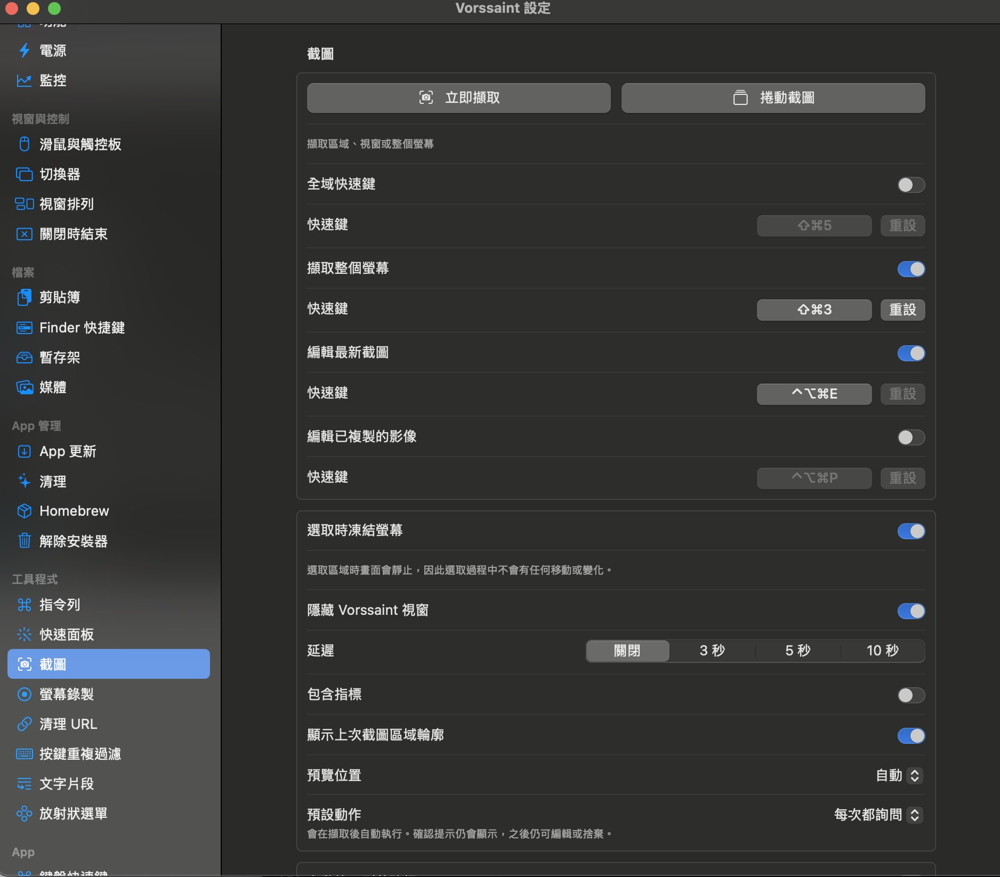
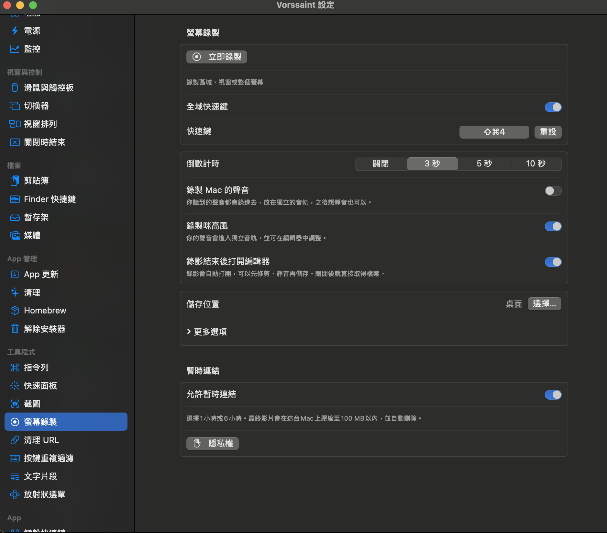
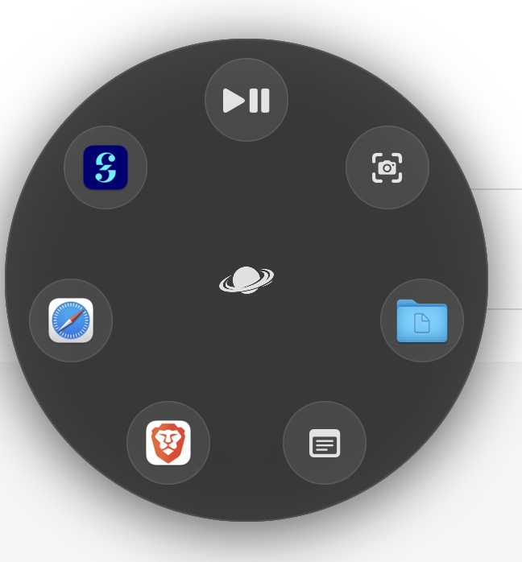
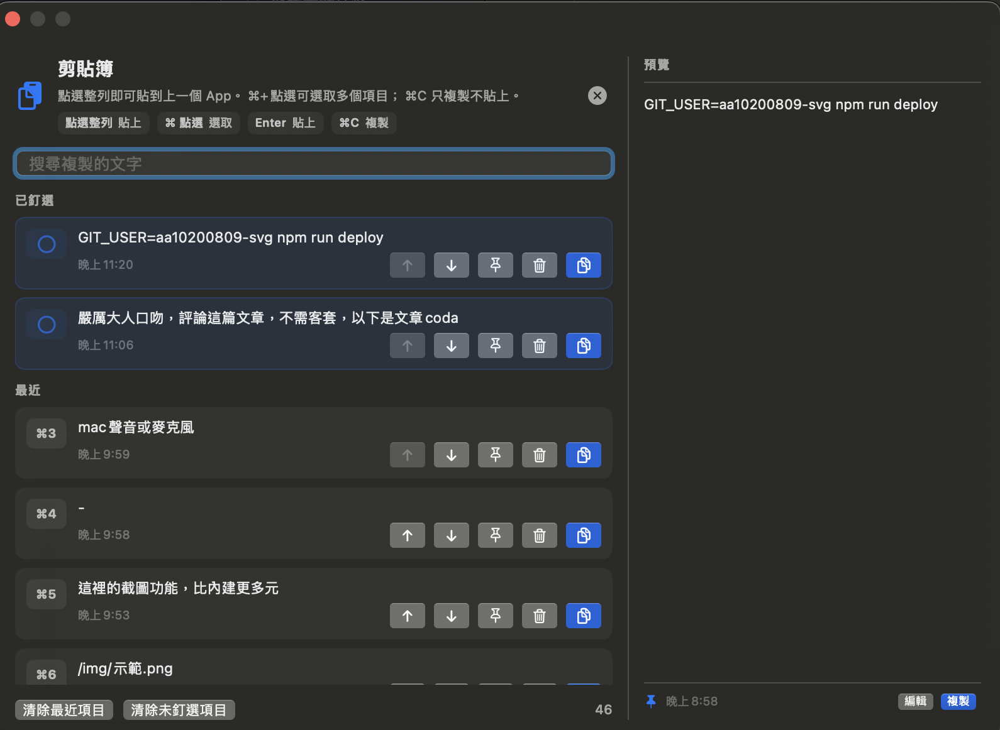
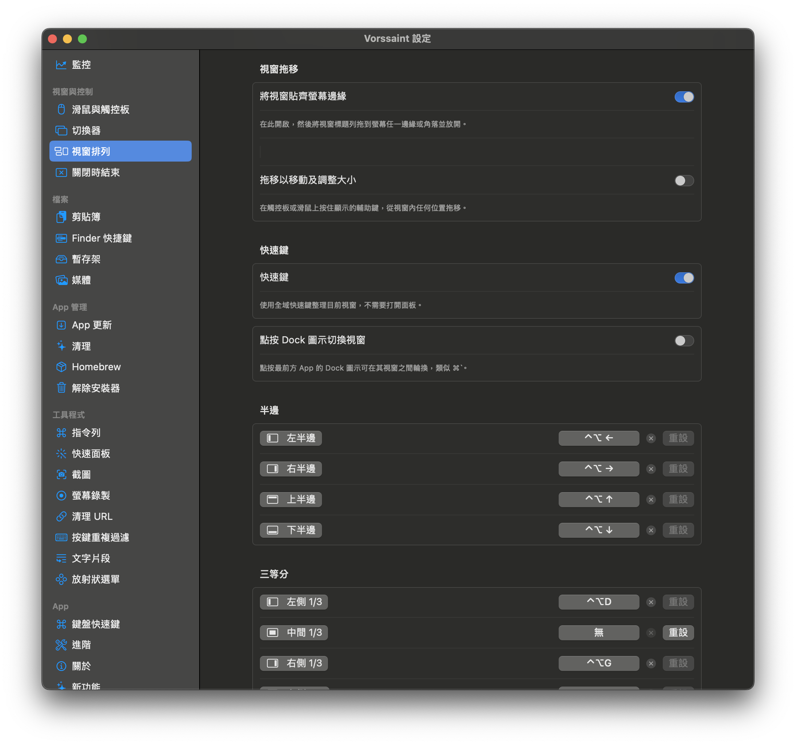
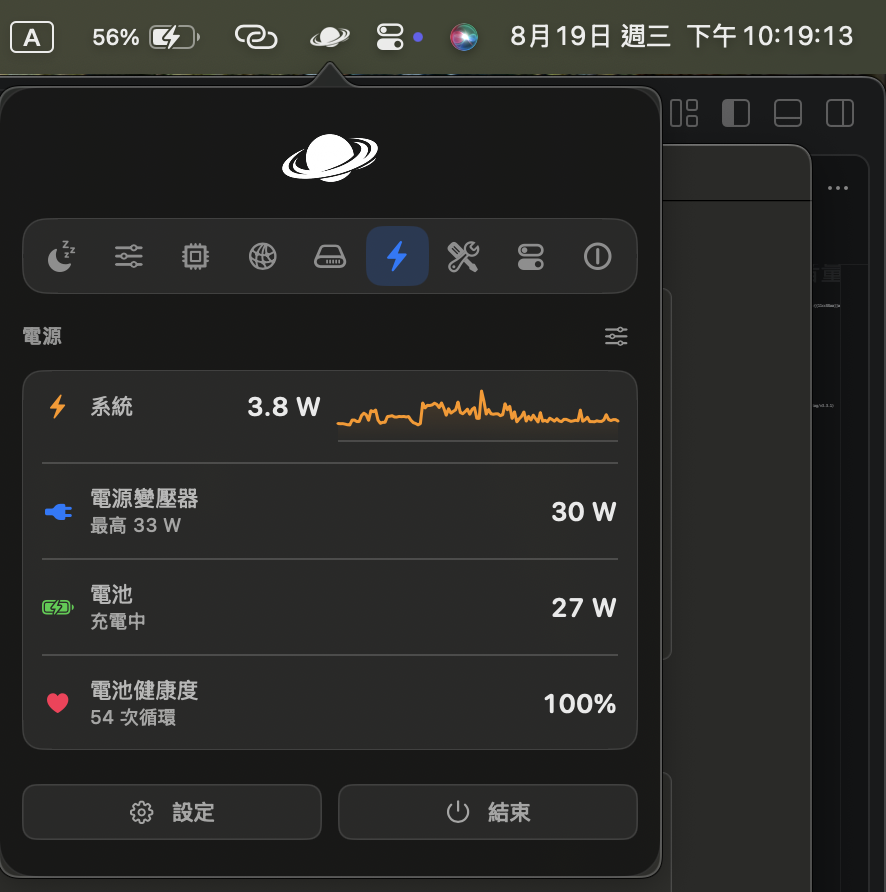

今天來介紹一款超厲害的工具

## vorssaint
這是一款完全**免費**、**開源**的macOS選單列工具，裡面有非常多的功能，例如:系統監控、保持 Mac 喚醒、應用程式音量控制、快速視窗切換、滑鼠滾輪方向調整、等等。

這邊介紹幾個

### 1.截圖、錄製螢幕

特別功能： 
- 截圖完後可直接編輯
- 錄製螢幕時可選擇mac聲音或麥克風
- 螢幕錄製完也可直接編輯，mac聲音和麥克風會是獨立音軌，都可調整

### 2.放射狀選單

這功能很方面，就是捷徑的概念，可設定成你常開的文件、app、等...

### 3.剪貼板

特別功能： 
- 儲存所有複製過的文字
- 可釘選複製文字

### 4.視窗排列
很多視窗的排列方式，都可設定快捷鍵

### 5.分區式面板
這裡可以看到很多資訊、設定 如:
- 設定各 App 的音量大小
- CPU、GPU、電池的溫度
- 目前功耗值、電池健康度
- 保持喚醒 （讓 Mac不進入睡眠模式）
- 記憶體資訊

先介紹到這邊，大家快去試試

### [**快來安裝看看吧！**](https://github.com/vorssaint/vorssaint-utils/releases/tag/v3.3.1)
